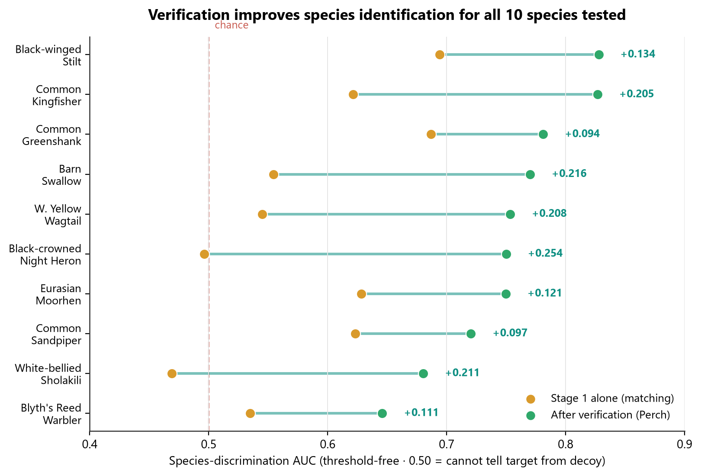
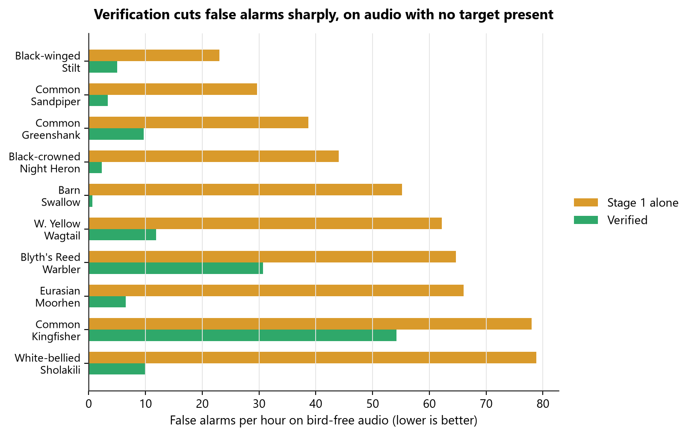
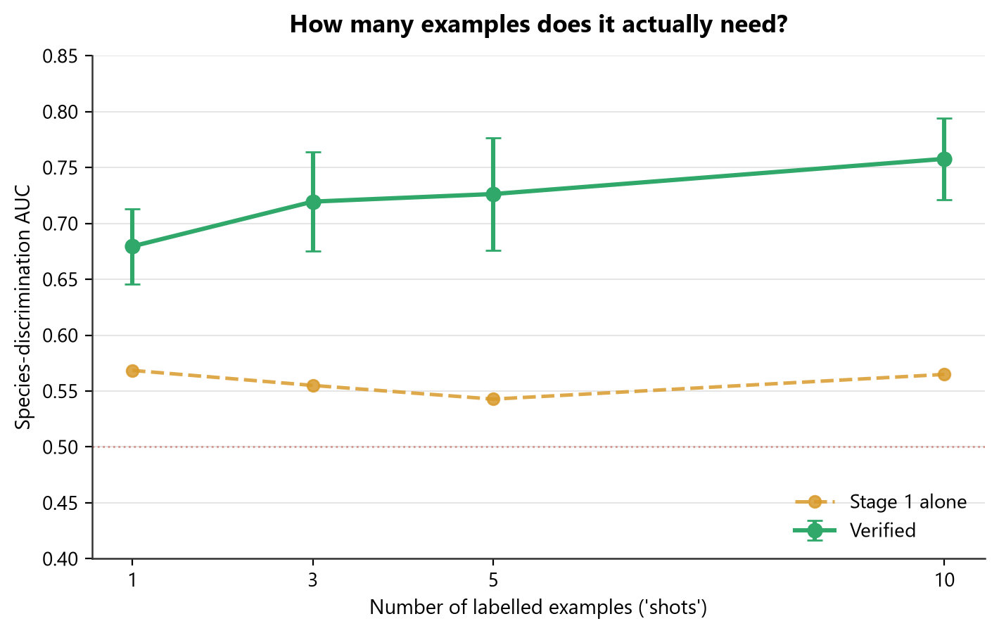

# ARGUS: Learning a Bird from Five Calls

Few-shot bioacoustic detection for a threatened Western Ghats bird. ARGUS learns a new species from five example calls, then checks each detection separately to make sure it really is that species and not a bird that sounds like it.

- **Live site:** https://argussite.vercel.app/
- **Paper:** [ARGUS_Research_Paper.pdf](submission/ARGUS_Research_Paper.pdf) (13 pages) and an [extended version](submission/ARGUS_Research_Paper_extended.pdf) (26 pages, every experiment in full)
- **Synopsis:** [ARGUS_IRIS_Synopsis.pdf](submission/ARGUS_IRIS_Synopsis.pdf) (2 pages)
- **Lab notebook:** [ARGUS_TrackA_Lab_Notebook.md](ARGUS_TrackA_Lab_Notebook.md)

By Subham Sai Samal and Vikramzharis, guided by Mrs. Valarmathy. IRIS National Fair 2026, Earth & Environmental Sciences.

## Why

The Western Ghats is one of Earth's eight hottest biodiversity hotspots and one of its least acoustically monitored. The White-bellied Sholakili (*Sholicola albiventris*), a Near Threatened endemic, has 22 recordings in BirdCLEF 2024, while most of the other species in our study have 500. Detectors usually need hundreds to thousands of examples, so the birds that most need monitoring are the hardest to monitor.

We asked two questions. Can a model learn a new species from five calls? And can it tell that species apart from the birds that sound most like it, instead of just noticing that some bird called?

## How it works

```
5 example calls
      |
      v
+----------------------+      +-----------------------+
| Stage 1: find        | ---> | Stage 2: check        | ---> detection
| small CNN, trained   |      | Google Perch v2       |
| from scratch, tuned  |      | embeddings + a small  |
| on the 5 calls       |      | classifier            |
+----------------------+      +-----------------------+
  fast, finds calls,            slower, decides
  weak on species               which species
```

- **Stage 1** is a small convolutional network (about 445,000 parameters) trained from scratch on 40 other species and fine-tuned for 250 steps on the five calls. It finds candidate calls but knows little about which species made them.
- **Stage 2** embeds each candidate with Google's Perch v2 and scores it with a logistic-regression classifier trained on the same five calls. This is what tells species apart.
- **Testing:** real target calls are planted into real Western Ghats forest recordings, so every answer is known. Each target is tested against the four species that sound most like it, picked automatically by acoustic similarity.

## Results



| | Stage 1 alone | With verification |
|---|---|---|
| Mean species-discrimination AUC, 10 species | 0.585 | **0.751** |
| Species improved | | **10 / 10** |
| Gain compared with measured run-to-run noise (0.032) | | **5.2×** |
| False alarms per hour on audio with no target | 54.0 | **13.4** |
| Independent full replications | | **4** (gains +0.165, +0.166, +0.161, +0.165) |

AUC of 0.5 means guessing and 1.0 is perfect. We measured the run-to-run noise of our own pipeline (0.032) and only count differences larger than that.

**The standard test cannot see species mix-ups.** The usual detection measure, average precision, barely moves with verification (0.611 to 0.604). Ranked by that measure, our best configuration comes last of six; ranked by species-discrimination AUC, it comes first.



**Other findings**

- **Five examples is a sensible choice, not a magic number.** Verified AUC is 0.680 with one example, 0.720 with three, 0.726 with five and 0.758 with ten. Only the step from one to three clears the noise floor.
- **Quiet calls are missed more often, but the ones that are found are identified just as well.**
- **Four published techniques did not help** in this five-shot setting. Our untouched baseline beat all of them.
- **Three alternative explanations were tested and ruled out:**
  - Perch alone reaches only 0.526 AUC and 2.5% recall.
  - Testing only on different recordists changes the result by −0.032, inside its 0.062 noise bound.
  - Harder negative examples made the pipeline worse, in 5 of 5 species.
- **Removing Perch does not work yet.** Distilling it into the small network (642,688 parameters, about 19 times smaller) cost 0.136 AUC on average and dropped the study species to chance (0.511). Widening the student eightfold did not help. We report this as a negative result.
- **First scan of 26.6 hours of unlabelled forest audio:** the study species was flagged 1.74 times as often as a control species on the same files. None of these detections has been confirmed by an expert yet.



## Limitations

- No external benchmark yet; the DCASE Task 5 benchmark is next.
- Target calls in the tests are planted, and no wild detection is confirmed.
- The five calls may come from only a few individual birds: 12 of the 22 recordings come from one team at one location.
- The pipeline still needs Perch at detection time.

We also keep a record of our own claims that we later withdrew, and why. It is in the lab notebook and in Appendix A of the extended paper.

## What is in this repository

```
index.html                      the live site (argussite.vercel.app)
submission/                     the paper, its extended version and the synopsis (PDF)
ARGUS_TrackA_Lab_Notebook.md    dated lab notebook
data/                           the eleven CSV files every number comes from
code/                           the pipeline, its tests and the Kaggle notebooks
assets/                         the charts in this README, generated from data/
old/                            an early notebook, kept for the record
```

**code/**

| File | What it does | Writes |
|---|---|---|
| `arguswala_setup_v2.py` | Cell 1: data loading, decoy selection, Perch set-up | |
| `arguswala_v2.py` | Cell 2: two-stage detection across all ten species | `argus_multispecies_results.csv` |
| `arguswala_sweeps.py` | Cell 3: number of examples, choice of examples, call loudness, decoy difficulty | the four `argus_sweep_*.csv` files |
| `arguswala_ladder.py` | Cell 4: ablation ladder of published techniques, and the noise floor | `argus_ablation_ladder.csv` |
| `arguswala_confounds.py` | Cell 5: the three alternative-explanation tests | `argus_confounds.csv` |
| `arguswala_distill.py` | Cell 6: distilling Perch into the small network | `argus_distill.csv` |
| `arguswala_frontier.py` | Cell 7: width sweep and the wild-audio scan | `argus_frontier.csv`, `argus_wildscan.csv` |
| `ARGUS_Kaggle_Notebook.ipynb` | the seven cells above as one notebook, built by `_build_notebook.py` | |
| `ARGUS_Demo_Snapshot.ipynb`, `arguswala_demo_v2.py` | make the snapshot of a real run that the live site replays | |
| `_test_*.py` | five test suites for the pipeline logic; no GPU or dataset needed | |

`data/argus_species_covariates.csv` holds per-species covariates (such as how similar a species' calls are to each other).

## Reproducing

1. On Kaggle, open `code/ARGUS_Kaggle_Notebook.ipynb`, attach the BirdCLEF 2024 competition data and the Perch v2 model, turn on a GPU and run the cells in order. A full run takes several GPU hours, and each cell writes its CSV to the output.
2. The tests run anywhere: `cd code`, then `python _test_v2_logic.py` (and the other four `_test_*.py` files).
3. Every number in the paper can be recomputed from `data/`. Appendix B of the extended paper says which file and column each one comes from.

## Built with

Python, PyTorch (stage-1 network, trained from scratch), TensorFlow Hub (Perch v2), scikit-learn, ONNX Runtime, librosa, and plain JavaScript for the site (hand-written SVG charts and the Web Audio API). Experiments ran on Kaggle GPUs.

## Acknowledgements

Thanks to Chiti Arvind (IISER Tirupati) for feedback on this species' song, and to Tom Denton (Google DeepMind) for answering our question about distilling Perch. Data: BirdCLEF 2024. Model: Perch v2.

Generative AI tools (Claude, Antigravity) wrote much of the code and helped draft the text in this repository. All experiments and results are our own.
